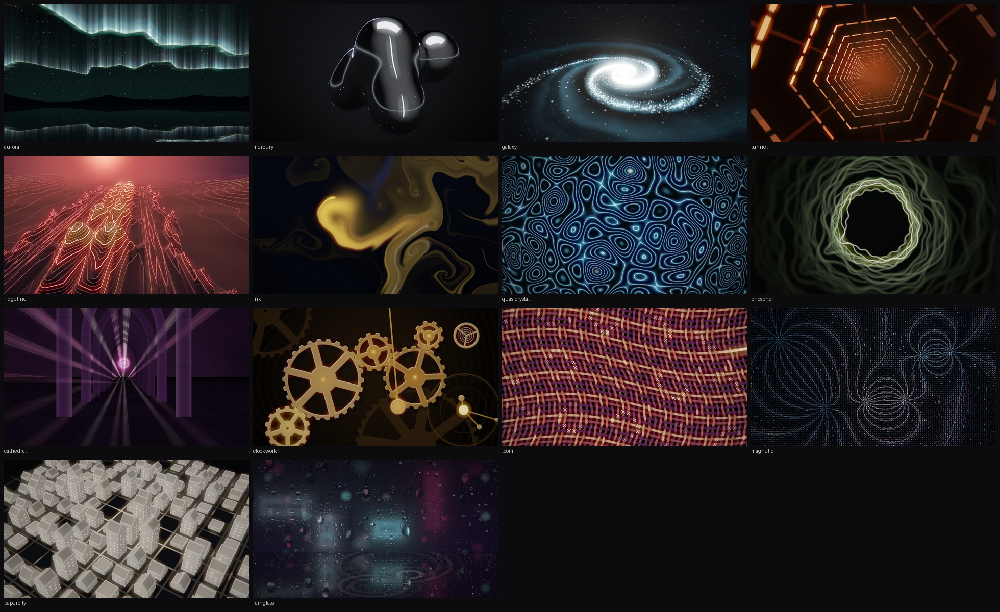
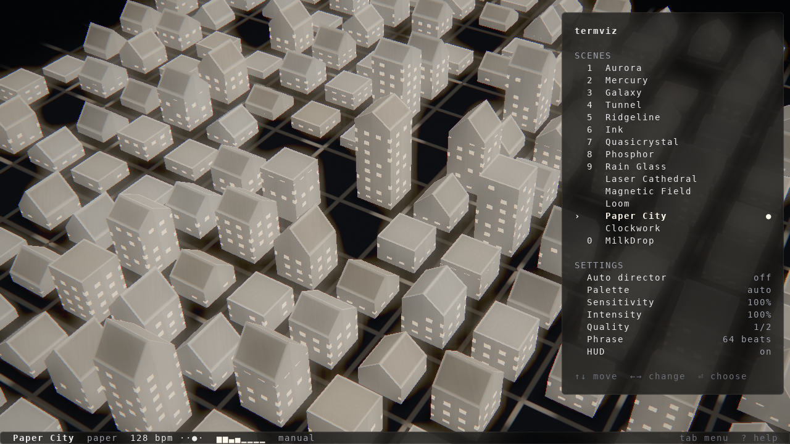

# gListening

Music, rendered in your terminal. Fourteen original GLSL scenes follow your system audio or an audio file, with beat detection, an automatic scene director, and keyboard controls.



## Installation

**Portability validation is in progress. No installable release has been published yet.** Native support and installation commands below are being tested in the public pull request.

Release bundles contain native executables for Linux x64, macOS Apple Silicon and Intel, and Windows x64. Node.js 20 or newer runs the npm launcher; end users do not need a C++ compiler. Download the npm `.tgz` from [Releases](https://github.com/namelesstherebel/glistening/releases), then:

```sh
npm install -g ./glistening-0.1.0.tgz
glistening setup                  # install platform dependencies
glistening                        # visualize system output
glistening --file song.flac        # play and visualize an audio file
glistening --file song.flac --mute # visualize without playback
```

`glistening setup --dry-run` shows installation commands without running them. Setup uses Homebrew on macOS, WinGet on Windows, and the distribution package manager on Linux. Install [Homebrew](https://brew.sh) first if absent; Windows needs App Installer / WinGet. Reopen the Windows terminal after dependency installation so FFmpeg is on PATH.

You can also use the native executable directly without Node.js. FFmpeg must be on PATH for file decoding.

| OS | Runtime requirements | Dependency setup |
|---|---|---|
| macOS 14.2+ | System OpenGL and CoreAudio; FFmpeg for files | `brew install ffmpeg` |
| Windows 10/11 x64 | GPU driver with OpenGL 3.3; WASAPI output endpoint; FFmpeg for files | `winget install --id Gyan.FFmpeg --exact --source winget` |
| Linux x64 | EGL/OpenGL 3.3; PulseAudio or PipeWire with Pulse compatibility; FFmpeg for files | `glistening setup` installs client tools, Mesa/EGL, and FFmpeg on Debian/Ubuntu, Arch, or Fedora |

macOS captures system output through CoreAudio taps. First use requires the system's audio-recording permission; approve the OS prompt. Windows uses WASAPI loopback on the default output. Linux captures the default output monitor through `parec`; an existing PulseAudio-compatible sound server must be running. A microphone is not substituted for system output.

For diagnostics, `glistening --self-test` checks all fourteen scenes without audio hardware. `glistening --check-audio --seconds 3` plays a quiet tone and verifies system-output capture; macOS may request recording permission.

## Terminals

Terminal graphics support determines image resolution. Auto detection uses kitty graphics when available and otherwise falls back to colored half blocks. Shell choice (PowerShell, Command Prompt, zsh, bash) does not select the graphics protocol.

| Terminal | Platforms | Output |
|---|---|---|
| kitty | macOS, Linux | Full-resolution kitty graphics |
| Ghostty | macOS, Linux | Full-resolution kitty graphics |
| Current iTerm2 | macOS | Kitty graphics when its capability query succeeds; blocks otherwise |
| WezTerm | macOS, Windows, Linux | Kitty graphics when enabled and detected; blocks otherwise |
| Windows Terminal | Windows | Truecolor half blocks |
| Apple Terminal on macOS 26+ | macOS | Truecolor half blocks |
| Other VT terminals with UTF-8 and 24-bit color | Varies | Half blocks; image detail follows terminal cell size |

Use a current terminal and monospace font with the `▀` half-block glyph. Older Apple Terminal versions lack full truecolor support; use kitty, Ghostty, or iTerm2 there. Set `VIZ_OUTPUT=blocks` to force the fallback. Over SSH use `VIZ_MEDIUM=direct`; audio is captured on the machine running gListening. Multiplexers must pass through graphics sequences or use blocks.

These entries describe protocol compatibility. Native builds, rendering, and package installation are tested separately from interactive display on each terminal. [kitty protocol](https://sw.kovidgoyal.net/kitty/graphics-protocol/), [Ghostty features](https://ghostty.org/docs/features), [iTerm2 graphics](https://iterm2.com/documentation-images.html), [WezTerm tracking](https://github.com/wezterm/wezterm/issues/986), [Apple Terminal color support](https://www.apple.com/my/os/pdf/All_New_Features_macOS_Tahoe_Sept_2025.pdf).

## Build from source

C++17 and CMake are required. On Debian/Ubuntu, install `g++ cmake pkg-config libegl1-mesa-dev libgl1-mesa-dri pulseaudio-utils ffmpeg`. On macOS, install Xcode Command Line Tools and `brew install cmake ffmpeg`. On Windows, use Visual Studio 2022 with Desktop development with C++, CMake, and FFmpeg.

```sh
cmake -S . -B build -DCMAKE_BUILD_TYPE=Release -DGLISTENING_PROJECTM=OFF
cmake --build build --config Release --parallel
ctest --test-dir build -C Release --output-on-failure
```

Run `build/glistening` on Unix or `build\Release\glistening.exe` on Windows. Linux also supports `make && ./glistening` and `make test`. Shaders are embedded, so the executable runs outside its build directory.

Release binaries contain all fourteen built-in scenes. MilkDrop is an optional source-build feature requiring the projectM 3.x C++ API and a compatible default framebuffer; it is not bundled in the prebuilt npm package.

## Scenes

| # | scene | idea | calm..busy |
|---|---|---|---|
| 1 | **Aurora** | curtains of light folding over a mountain lake; folds seen edge-on burn brightest, the hem flares on beats, bars send a fold along the curtain | 0.15 |
| 2 | **Mercury** | liquid chrome in a dark studio; each blob swells with its own band, bass merges them, highs glint | 0.55 |
| 3 | **Galaxy** | 60k instanced stars in a spiral; bass lights the core, every beat sends a shockwave ring out through the arms | 0.40 |
| 4 | **Tunnel** | a hexagonal corridor whose rings replay the last ~3 s of spectrum (bass on the floor, highs on the ceiling); beats run light down it | 0.85 |
| 5 | **Ridgeline** | the spectrum history as a contoured landscape at dusk: kicks become hill pairs, held notes become ridges | 0.50 |
| 6 | **Ink** | luminous dye in a curl-noise current: bass puffs on beats, mids stream, highs draw fibres, the water lurches on kicks | 0.30 |
| 7 | **Quasicrystal** | 5- or 7-fold interfering waves folded into rosettes that never repeat; the plate clicks round every 16 beats | 0.45 |
| 8 | **Phosphor** | the waveform bent into a ring and drawn by a CRT beam; each trace drifts outward as it cools and jumps on the beat | 0.70 |
| 9 | **Rain Glass** | rain on a window over a blurred neon street; bass ripples the puddles, mids drag drops into trails, highs tap the glass | 0.10 |
| | **Laser Cathedral** | light fans through haze under towering arches; bass widens the beams, mids steer them, highs split them, drops reveal the chamber | 0.80 |
| | **Magnetic Field** | glowing filings tracing three invisible magnets, one per band; kicks snap the filings into line | 0.60 |
| | **Loom** | luminous threads weaving an evolving fabric; bass pulls the threads taut, mids bend the weave, highs embroider it, each phrase sets a new pattern | 0.35 |
| | **Paper City** | folded paper buildings rise from a dark plane, each district a band; beats run light down the streets, breakdowns fold the skyline flat | 0.65 |
| | **Clockwork** | meshing gears, a pendulum, an orrery and a balance wheel; the music clock turns the train and beats kick it on, bass swings the pendulum, mids open the orbits, highs shiver the balance wheel, downbeats engage the front gear | 0.50 |
| 0 | **MilkDrop** | projectM presets, with the learned preset library below | |

Contact sheets (silence, breakdown, drop, groove on the beat) are in [`docs/`](docs): [aurora](docs/aurora.png), [mercury](docs/mercury.png), [galaxy](docs/galaxy.png), [tunnel](docs/tunnel.png), [ridgeline](docs/ridgeline.png), [ink](docs/ink.png), [quasicrystal](docs/quasicrystal.png), [phosphor](docs/phosphor.png), [rainglass](docs/rainglass.png), [cathedral](docs/cathedral.png), [magnetic](docs/magnetic.png), [loom](docs/loom.png), [papercity](docs/papercity.png), [clockwork](docs/clockwork.png). Scenes without a number key are chosen in the `tab` panel, with `--scene`, or by `→`/the director. Each appearance of a scene gets a new seed, camera, and palette from its curated set.

Audio mapping, shared by all scenes: bass → mass, scale, camera push; mids → shape and flow; highs → sparkle and fine detail; beat → an accent with a ~30 ms rise and a tempo-scaled fall (never a strobe); downbeats and drops → bigger moments; slow energy → overall intensity. A music clock (`uFlow`) speeds motion up with energy, so nothing jumps. The post pass adds bloom, chromatic aberration only on drops, a vignette and dithering. A flash limiter caps how fast mean luminance can rise per frame (it re-runs the post pass at lower exposure if a frame would exceed it).

## Controls



| key | |
|---|---|
| `tab` | control panel: scenes, auto director, palette, sensitivity, intensity, quality, phrase length, HUD (`↑↓` move, `←→` change, `⏎` choose) |
| `?` | key help |
| `1`–`9`, `0`/`m` | choose one of the first nine scenes / MilkDrop mode (the rest are in the `tab` panel) |
| `space`, `→`/`n` | next scene (the director's energy-matched pick) |
| `←`/`p` | previous scene |
| `a` | auto director on/off |
| `c` | cycle palette: auto (each scene's own) → desktop (Omarchy theme) → named palettes |
| `r` | new look for the current scene (seed, camera, palette) / random MilkDrop preset |
| `+` `-` | sensitivity · `[` `]` effect intensity · `h` HUD |
| `f` `b` | favourite / ban the MilkDrop preset |
| `R` | reload shaders from `$VIZ_SHADERS` (or `./scenes`, `./shaders`) |
| `i` | what's on screen · `q`/`esc` quit (`esc` closes overlays first) |

The HUD shows the scene, palette, tempo with the bar position, an 8-band spectrum, and the director's phrase count. Panels get a frosted backdrop baked into the image under them, so they stay legible over any scene, in any terminal.

## Command line

```
glistening [--scene NAME] [--file AUDIO] [--mute] [--milkdrop] [--no-director]
        [--list-scenes] [--dump OUT.ppm [--seconds S] [--size WxH]] [--help]
```

`--dump` renders headless and writes a PPM: one frame after S seconds, or every frame if OUT contains `%d` (e.g. `frames/%05d.ppm`). With `--file` it decodes as fast as it can render.

## How it picks

- **Analysis** (`analysis.hpp`): per-band onset flux → tempo by autocorrelation with a 120 BPM prior → a beat clock phase-locked to onsets, with beat and bar phase ramps. Drops are bass arriving ≥12 dB above the previous 0.5–3 s; they re-anchor bar counting. Section changes are when the short-term band balance leaves the long-term one. There's also a 64-band log spectrum (30 Hz–16 kHz) and the waveform. `music.hpp` eases all of this to frame rate.
- **When** (`Director`): a drop gives an immediate hard cut (≥4 s since the last). A section change gives a soft cut on the next downbeat (≥12 s). Otherwise it soft-cuts on the first downbeat after the phrase length (64 beats). With no clear beat (confidence < 0.25) it falls back to a 30 s timer. Silence holds. Soft cuts are a noise-field dissolve over about a bar.
- **Which scene** (`ScenePicker`): the scene whose calm..busy rating is closest to the music's slow energy, plus jitter. Drops ask for the busiest. It never repeats one of the last two.
- **Which preset** (MilkDrop, `Library`): it learns each preset's motion and brightness while it plays, then picks busy presets for loud passages and calm ones for quiet. Favourites are weighted up; banned and broken presets never return. Stored in `~/.config/glistening/presets.tsv`.

## Config

Settings are written when you change something: `~/.config/glistening/config` on macOS/Linux (`$XDG_CONFIG_HOME/glistening/config` when set), or `%APPDATA%\glistening\config` on Windows. Preset history uses the same directory.

```
scene=aurora
palette=auto
director=1
milkdrop=0
hud=1
cellbg=0
gain=1
intensity=1
scale=2
phrase=64
```

`palette=desktop` builds a palette from the current Omarchy theme (`~/.local/state/omarchy/current/theme/colors.toml`). If the theme is missing it falls back to the scene's own palettes.

| env | default | |
|---|---|---|
| `VIZ_OUTPUT` | auto | `kitty` or `blocks`; auto asks the terminal (kitty graphics query) |
| `VIZ_MEDIUM` | `shm` on Unix; `direct` on Windows/SSH | `direct` = base64 in-band; shared memory requires a local compatible terminal |
| `VIZ_CELLBG` | `0` | `1`: image below cell backgrounds (kitty z < -1073741824) and solid panel cells |
| `VIZ_FPS` | `30` | |
| `VIZ_PCM_CMD` | unset: native capture on macOS/Windows, `parec` monitor on Linux | override with a shell command printing f32le stereo 44.1 kHz |
| `VIZ_SHADERS` | | directory with `scenes/` and `shaders/` to load instead of the embedded copies (hot reload with `R`) |
| `VIZ_SEED` | random | fixed seed for reproducible looks |
| `VIZ_EGL` | | `default` or `surfaceless` to force an EGL path |
| `VIZ_PRESETS` | `/usr/share/projectM/presets` | |
| `VIZ_DUMP_UI` | | with `--dump`: `panel`/`help` open, and write the text layer to `OUT.cells` |

## Development

- `scenes/*.frag` are the scenes. The `// @name`, `@desc`, `@busy` (0..1), `@bloom` and `@palettes` header lines are read at load. `scenes/NAME.vert` adds an instanced particle pass (`// @particles N`); see `galaxy.vert` and `phosphor.vert`. `scenes/common.glsl` documents the uniforms. Shaders are embedded at build time (`shaders.inc`), so the binary runs from anywhere.
- `make test`: unit gates (analysis, director, library, spectrum and phases, scene choice, TUI layout at 40×12 to 200×60, keys, kitty and half-block encoders, config, Omarchy parsing). Then the render gate, which checks all 14 built-in scenes load and renders every scene on silence and on a synthetic track with a drop and checks it's not black, not flat, finite, reacts to the music, shows beat accents aligned with beats, and never flashes.
- `make sheets`: contact sheets into `docs/`. `tools/ptyrun.py` drives the real binary in a pseudo-terminal (pyte), and `tools/screenshot.py` composites `--dump` frames with their text layer.

Files: `viz.cpp` (main loop, CLI), `engine.hpp` (renderer), `gl.hpp` (GL loader), `gpu.hpp` (platform context), `analysis.hpp`, `music.hpp`, `director.hpp`, `tui.hpp`, `term.hpp` (output encoders), `config.hpp`, `milkdrop.hpp`.

## License

GNU General Public License version 3 only (GPL-3.0-only). See [LICENSE](LICENSE). Corresponding source is in this repository; release tags identify the source used for each binary bundle.
