# Demo media

**Status:** an actual run on 27 Oct 2026 produced all 14 clips, JPG previews, the original `demo-audio.wav` and `manifest.json` (6.4 MiB total) with [`scripts/capture-demos.py`](../../scripts/capture-demos.py). Asset hashes and ffprobe results were verified. These are offscreen renders only; no live audio capture is claimed.

The tool generates, for each of the fourteen built-in scenes, `ID.mp4` and a JPEG preview `ID.jpg`. These are output of the actual application's offscreen renderer (`--dump`), not recordings of a terminal screen, so they do not show the TUI or half-block detail. Clips contain moving, sometimes bright, music-reactive imagery.

## Format

- 6 seconds, 24 fps, 640×360, H.264 yuv420p, AAC 96 kbps, faststart.
- Audio is `demo-audio.wav`: original, deterministic synthesized tone and percussion, stereo 44.1 kHz. It uses no external samples and no commercial music.
- Each scene is rendered from that audio with a fixed seed.

## Reproduce

From the repository root (Python standard library plus `ffmpeg` and `ffprobe` on PATH; no pip install):

```sh
cmake -S . -B build -DCMAKE_BUILD_TYPE=Release
cmake --build build --config Release --parallel
python3 scripts/capture-demos.py --binary build/glistening --output docs/demos --force
```

- `--force` is required here because this repository tracks the generated media. It overwrites the existing demo assets in `docs/demos`; without it, the tool safely refuses to overwrite them.
- `--scene ID` captures one scene.

The script's probe checks each clip: H.264 video, AAC audio, 640×360, yuv420p, 24 fps, 144 frames, 6 s. The manifest records the exact source commit, binary SHA-256, commands, asset hashes, ffmpeg/ffprobe/Python versions, capture constants (fps, seed, duration, size), and platform and probe data.

Replay can differ in pixels across GPU and driver versions. The seed controls the look; it does not guarantee bit-identical output everywhere.

## Scenes

Preview links carry alt text; videos may play differently via GitHub's download or player.

Scene shortcut keys, in the order below: `1` `2` `3` `4` `5` `6` `7` `8` `9` `z` `x` `v` `g` `t` (aurora through clockwork). `←`/`→` step through the same order and wrap across all 14 built-ins outside the control panel; `n`/`space` pick a random next scene and `p` returns through history. In the control panel the arrows adjust settings, and in MilkDrop they keep changing presets.

| Key | ID | Key | ID |
|---|---|---|---|
| `1` | aurora | `9` | rainglass |
| `2` | mercury | `z` | cathedral |
| `3` | galaxy | `x` | magnetic |
| `4` | tunnel | `v` | loom |
| `5` | ridgeline | `g` | papercity |
| `6` | ink | `t` | clockwork |
| `7` | quasicrystal | | |
| `8` | phosphor | | |

| ID | Preview | Video |
|---|---|---|
| aurora | [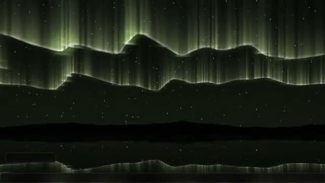](aurora.mp4) | [aurora.mp4](aurora.mp4) |
| mercury | [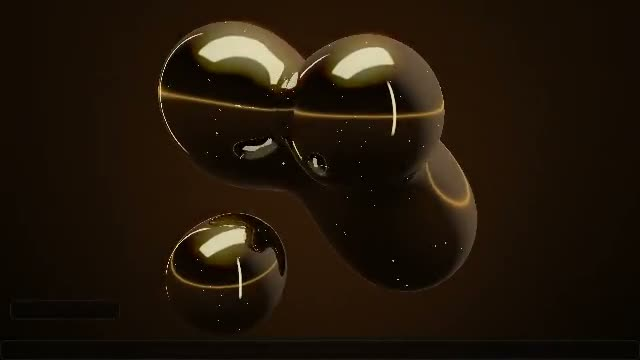](mercury.mp4) | [mercury.mp4](mercury.mp4) |
| galaxy | [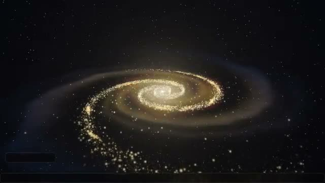](galaxy.mp4) | [galaxy.mp4](galaxy.mp4) |
| tunnel | [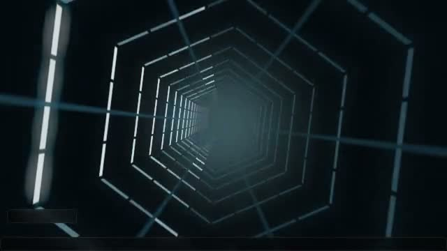](tunnel.mp4) | [tunnel.mp4](tunnel.mp4) |
| ridgeline | [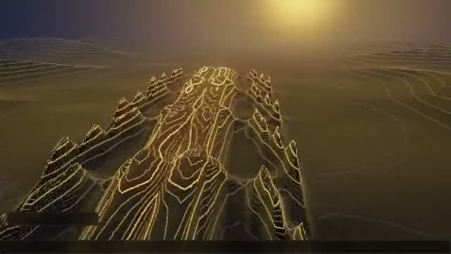](ridgeline.mp4) | [ridgeline.mp4](ridgeline.mp4) |
| ink | [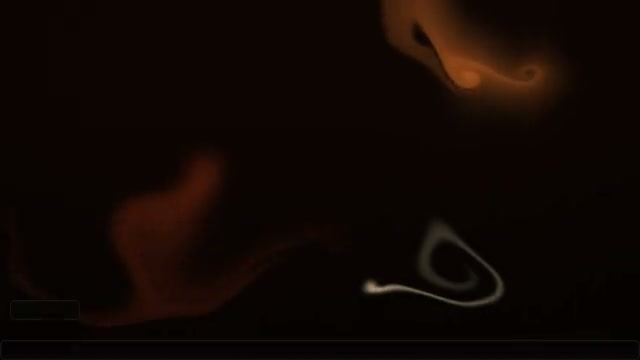](ink.mp4) | [ink.mp4](ink.mp4) |
| quasicrystal | [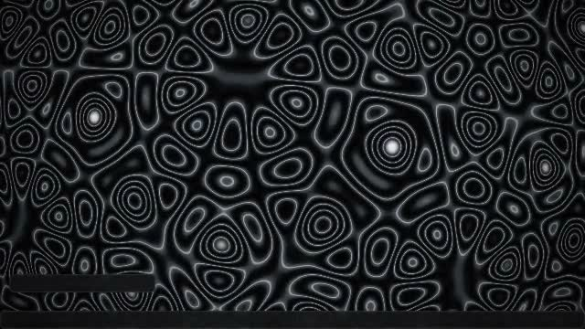](quasicrystal.mp4) | [quasicrystal.mp4](quasicrystal.mp4) |
| phosphor | [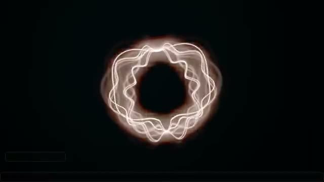](phosphor.mp4) | [phosphor.mp4](phosphor.mp4) |
| rainglass | [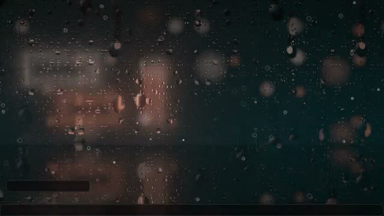](rainglass.mp4) | [rainglass.mp4](rainglass.mp4) |
| cathedral | [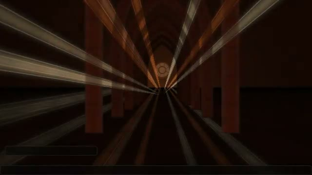](cathedral.mp4) | [cathedral.mp4](cathedral.mp4) |
| magnetic | [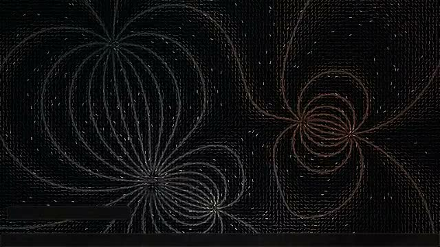](magnetic.mp4) | [magnetic.mp4](magnetic.mp4) |
| loom | [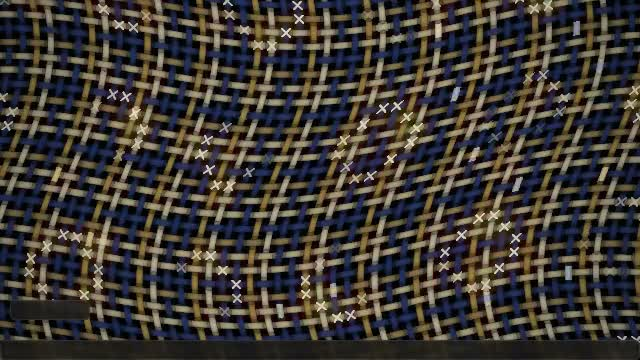](loom.mp4) | [loom.mp4](loom.mp4) |
| papercity | [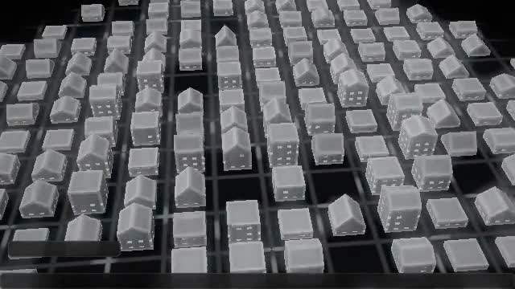](papercity.mp4) | [papercity.mp4](papercity.mp4) |
| clockwork | [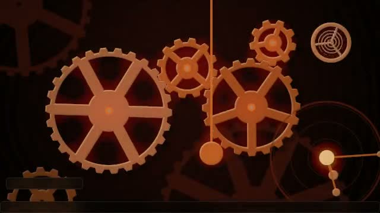](clockwork.mp4) | [clockwork.mp4](clockwork.mp4) |

## MilkDrop

MilkDrop is an optional Linux-only source-build feature (projectM 3.x context; see the [architecture](../architecture.md)). It is not captured on macOS and has no clip here. Any future capture needs a Linux renderer and a preset-specific license review; no presets are downloaded.

## License

The repository's existing GPL-3.0-only license ([LICENSE](../../LICENSE)) governs repository-owned source and generated media. The audio is generated by the repository tool; this adds no third-party-rights claim and no new license. See the [README](../../README.md) for the project overview.
